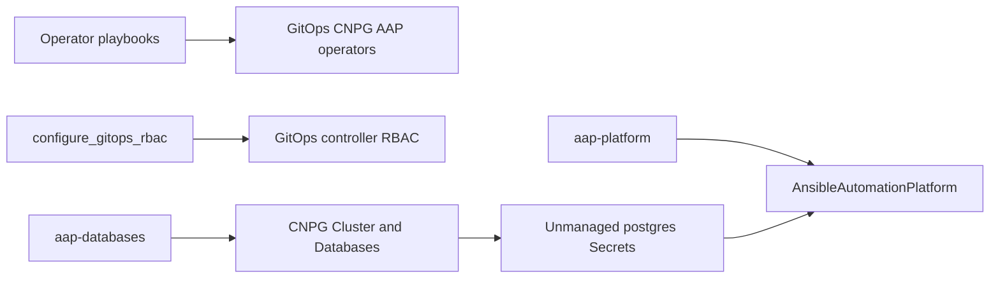

# AAP GitOps with external CloudNativePG database

Bootstrap an OpenShift cluster with OpenShift GitOps, CloudNativePG, and the Ansible Automation Platform (AAP) operator, then deploy AAP with **external PostgreSQL** managed by two Argo CD Applications.

Operators are installed with Ansible playbooks. Instance CRs (Postgres + AAP) are managed by GitOps.

### Reusing an existing PostgreSQL database in a GitOps fashion

The main idea is that the **database can live outside GitOps** (or outlive the AAP Application), while AAP itself is fully GitOps-managed:

1. Point AAP at an existing external PostgreSQL instance with unmanaged DB Secrets.
2. Delete the Argo CD Application `aap-platform` when you tear down AAP.
3. A **PostDelete** hook drops all application tables in those databases (data and schema objects created by AAP).
4. Recreate / sync `aap-platform` to redeploy AAP; the operator **re-initializes the DB schema** on the same PostgreSQL instance.

That lets you reuse durable Postgres capacity across AAP lifecycle cycles without keeping leftover AAP schema/data between deploys. This repo’s `aap-databases` app is one way to provision that Postgres (via CloudNativePG); you can instead wire Secrets to any existing Postgres that AAP can reach—the cleanup-on-delete + re-init-on-redeploy pattern is the same.

## Architecture

```text
playbooks/                     # one-time / bootstrap (cluster-admin)
  deploy_openshift_gitops.yml
  deploy_cloudnative_pg.yml
  deploy_aap_operator.yml
  configure_gitops_rbac.yml    # extra RBAC for CNPG, AAP, Secrets, Jobs, Projects

gitops/
  argocd/                      # Argo CD Application CRs (apply manually or via app-of-apps)
  databases/                   # App: aap-databases  → namespace aap-postgres
  aap/                         # App: aap-platform   → namespace aap
```

| Application | Path | Namespace | Contents |
|-------------|------|-----------|----------|
| `aap-databases` | `gitops/databases` | `aap-postgres` | CNPG `Cluster`, `Database` CRs, role password Secrets |
| `aap-platform` | `gitops/aap` | `aap` | `AnsibleAutomationPlatform`, unmanaged DB Secrets, PostDelete cleanup Job |

One CNPG Cluster (`aap-pg`) hosts separate databases for gateway, controller, hub (`hstore`), EDA, and metrics. AAP connects with `type: unmanaged` Secrets.



## Prerequisites

- OpenShift cluster and `cluster-admin` kubeconfig (`KUBECONFIG` or `~/.kube/config`)
- `oc` and Ansible with `kubernetes.core`
- StorageClass `gp3-csi` (used for CNPG and hub file storage; hub is RWO-friendly with `replicas: 1`)
- Red Hat and Certified Operator catalogs (`redhat-operators`, `certified-operators`)

Install collections:

```bash
ansible-galaxy collection install -r collections/requirements.yml -p collections
```

## Bootstrap order

1. **Install operators**

   ```bash
   ansible-playbook playbooks/deploy_openshift_gitops.yml
   ansible-playbook playbooks/deploy_cloudnative_pg.yml
   ansible-playbook playbooks/deploy_aap_operator.yml
   ansible-playbook playbooks/configure_gitops_rbac.yml
   ```

2. **Set real passwords and static encryption keys** in the Secret manifests under:
   - `gitops/databases/secrets/examples/` (`aap-pg-aap-password`, `aap-pg-ms-awx-readonly-password`)
   - `gitops/aap/secrets/examples/` (unmanaged AAP DB Secrets **and** encryption key Secrets)

   Use the **same** password for the `aap` role Secret and the AAP component Secrets that use username `aap`. Do not use `'`, `"`, or `\` in passwords.

   Replace `CHANGE_ME_*` encryption key placeholders with stable generated values (see Secrets below). Keep them unchanged across redeploys if encrypted DB content must remain readable.

3. **Commit / push** (Applications track `main` on this repo).

4. **Create Argo CD Applications**

   ```bash
   oc apply -f gitops/argocd/
   ```

5. Wait for `aap-databases` (Cluster healthy, Databases ready), then for `aap-platform`.

Optional: grant metrics read-only user `SELECT` on the controller DB after it exists (see comments in `gitops/databases/secrets/examples/aap-pg-ms-awx-readonly-password.yaml`).

## Secrets

Example Secrets are synced by Kustomize/Argo (listed in each app’s `kustomization.yaml`). They ship with `CHANGE_ME` placeholders—replace before relying on a real deploy.

| Secret | Namespace | Purpose |
|--------|-----------|---------|
| `aap-pg-aap-password` | `aap-postgres` | CNPG managed role `aap` |
| `aap-pg-ms-awx-readonly-password` | `aap-postgres` | Metrics read-only role |
| `external-postgres-configuration-*` | `aap` | AAP unmanaged DB connection (`type: unmanaged`) |
| `automation-platform-metrics-postgres-configuration` | `aap` | Metrics R/W DB |
| `metrics-controller-readonly-configuration` | `aap` | Metrics RO access to controller DB |
| `aap-controller-secret-key` | `aap` | Controller `SECRET_KEY` (`stringData.secret_key`) |
| `aap-hub-secret-key` | `aap` | Hub Django `SECRET_KEY` (`stringData.secret_key`) |
| `aap-hub-db-fields-encryption` | `aap` | Hub Fernet DB fields key (`database_fields.symmetric.key`) |
| `aap-eda-db-fields-encryption` | `aap` | EDA DB fields key (`stringData.secret_key`) |
| `aap-gateway-db-fields-encryption` | `aap` | Gateway DB fields key (`stringData.secret_key`) |

Host used by AAP: `aap-pg-rw.aap-postgres.svc.cluster.local:5432`.

### Static encryption keys

Per Red Hat [Creating a secret key secret](https://docs.redhat.com/en/documentation/red_hat_ansible_automation_platform/2.4/html/deploying_the_red_hat_ansible_automation_platform_operator_on_openshift_container_platform/aap-migration#create-secret-key-secret_aap-migration), provide fixed keys so the operator does not generate new ones each install. Wired in `ansibleautomationplatform.yaml` as:

- `spec.db_fields_encryption_secret` → gateway
- `spec.controller.secret_key_secret` → controller
- `spec.hub.secret_key_secret` / `spec.hub.db_fields_encryption_secret` → hub
- `spec.eda.db_fields_encryption_secret` → EDA

Generate examples:

```bash
python3 -c 'import secrets; print(secrets.token_urlsafe(50))'   # controller / hub Django / eda / gateway
python3 -c 'from cryptography.fernet import Fernet; print(Fernet.generate_key().decode())'  # hub DB fields
```

## PostDelete database cleanup (reuse Postgres across AAP deploys)

This is what makes **GitOps AAP + durable external Postgres** practical: the database instance stays up; only AAP’s data/schema are wiped on Application delete so the next deploy starts clean.

`gitops/aap/hooks/postdelete-truncate-databases.yaml` is an Argo CD **PostDelete** Job on **`aap-platform`**.

It runs only when the **Application** `aap-platform` is deleted (not when you only delete the `AnsibleAutomationPlatform` CR).

Lifecycle:

1. Argo deletes normal `aap-platform` resources (including AAP Secrets).
2. Argo creates the PostDelete Job in **`aap-postgres`**.
3. The Job **resets the `public` schema** in `platform_gateway`, `automation_controller`, `automation_hub`, `automation_eda`, and `metrics_service` (`DROP SCHEMA public CASCADE` + recreate). That removes tables **and** leftovers such as Hub/Pulp’s `pulp_ansible_semver` collation, types, and functions—not just table rows/definitions.
4. On the next sync/create of `aap-platform`, AAP reconnects to the same databases and **re-initializes the schema** (migrations / first-time setup).

Credentials come from `aap-pg-aap-password` in **`aap-postgres`** (same namespace as the Job). That Secret belongs to **`aap-databases`**, so it survives `aap-platform` deletion—required because PostDelete cannot rely on Secrets that were part of the deleted Application.

Important:

- `secretKeyRef` cannot read Secrets from another namespace. The Job must stay in `aap-postgres` next to `aap-pg-aap-password`.
- Keep `aap-databases` (or your external Postgres + credentials) available when deleting `aap-platform`, or the Job has nothing to connect to.
- Kubernetes expands `$` in container commands; the hook avoids PL/pgSQL `$$` and drops tables via a shell loop.

If Application deletion gets stuck on the hook:

```bash
oc -n openshift-gitops patch application aap-platform --type json \
  -p '[{"op":"remove","path":"/metadata/finalizers"}]'
```

That skips cleanup. Prefer fixing RBAC / the Job and letting PostDelete succeed.

## GitOps RBAC

Default OpenShift GitOps cannot manage CNPG/AAP CRs, create Secrets/Jobs for these apps, or always handle OpenShift `Project` cleanly. Run:

```bash
ansible-playbook playbooks/configure_gitops_rbac.yml
```

This grants the GitOps application-controller (and server) access to the needed API groups, adds Job permissions in `aap-postgres`, and excludes `project.openshift.io/Project` from Argo tracking.

## Hub storage note

Hub uses `file` storage on `gp3-csi` with `replicas: 1`. `gp3-csi` is typically **RWO**. Multi-replica hub needs an RWX StorageClass (for example ODF CephFS); change `spec.hub.file_storage_storage_class` in `gitops/aap/ansibleautomationplatform.yaml` if required.

## Useful commands

```bash
# Application status
oc -n openshift-gitops get applications

# CNPG
oc -n aap-postgres get cluster,database,pods

# AAP
oc -n aap get ansibleautomationplatform

# Preview kustomize output
kubectl kustomize gitops/databases
kubectl kustomize gitops/aap
```

## Support note

CloudNativePG is used here as a convenient external Postgres for demos/labs. Treat production database support according to your PostgreSQL vendor and Red Hat AAP external-database guidance.
